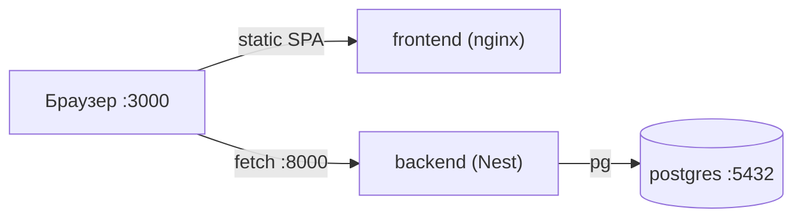

# Olimp Warehouse

Full-stack приложение для обработки конкурентных банковских транзакций. Пользователь выбирает персон, задаёт сумму и отправляет пачку транзакций, которые обрабатываются параллельно с гарантией идемпотентности и защитой от овердрафта. Баланс банка и лог транзакций обновляются в реальном времени.

## Обзор

Монорепозиторий на pnpm из трёх пакетов:

- **`backend`** — REST API на NestJS + PostgreSQL + TypeORM. Обрабатывает пачки транзакций параллельно, атомарно изменяет баланс банка, обеспечивает идемпотентность по ключу и восстановление «зависших» транзакций.
- **`frontend`** — SPA на React + Vite + TanStack Query + Tailwind CSS. Форма выбора персон и суммы, карточка баланса и лог транзакций с обновлением через polling.
- **`libs/contracts`** — общие TypeScript-интерфейсы и enum (`@olimp/contracts`), единый источник типов запросов/ответов для бэкенда и фронтенда.

### Поток данных



### API

| Метод | Путь | Описание |
|---|---|---|
| `POST` | `/v1/transactions` | Пачка транзакций `{ transactions: [{ personId, bankId, amount, key }] }` → `{ transactions: TransactionResult[], processingTimeMs }` |
| `GET` | `/v1/transactions?page&limit` | Лог транзакций (пагинация, сортировка по дате) |
| `GET` | `/v1/banks/:id` | Баланс банка `{ id, balance }` |
| `GET` | `/v1/persons?page&limit` | Список персон `{ id, name }[]` |

При старте бэкенд автоматически создаёт схему БД (`synchronize: true`) и сидит данные: один банк с балансом 100 000 и пять персон.

## Запуск

### Требования

- Docker и Docker Compose — для запуска через контейнеры
- Node.js 22+ и pnpm 10+ — для запуска в режиме разработки

### Вариант 1: Docker (рекомендуется для проверки)

Поднимает все три сервиса одной командой:

```bash
docker compose up --build
```

- Фронтенд: http://localhost:3000
- API: http://localhost:8000
- PostgreSQL: localhost:5432

Бэкенд дожидается готовности Postgres (healthcheck) и при старте сам создаёт схему и сид-данные. Остановить: `Ctrl+C`, удалить данные БД: `docker compose down -v`.

### Вариант 2: Разработка (pnpm)

1. Установить зависимости:

```bash
pnpm install
```

2. Поднять только PostgreSQL:

```bash
docker compose up postgres_db
```

3. Создать `backend/.env` на основе примера (для локального запуска `POSTGRES_HOST=localhost`):

```bash
cp backend/.env.example backend/.env
```

4. Запустить бэкенд и фронтенд в отдельных терминалах:

```bash
pnpm start:backend   # NestJS watch на :8000
pnpm start:frontend  # Vite dev-server на :3000
```

### Переменные окружения

**Backend** (`backend/.env`):

| Переменная | По умолчанию | Описание |
|---|---|---|
| `PORT` | `8000` | Порт HTTP-сервера |
| `POSTGRES_HOST` | — | Хост БД (`localhost` локально, `postgres_db` в Docker) |
| `POSTGRES_PORT` | `5432` | Порт БД |
| `POSTGRES_DB` | — | Имя базы |
| `POSTGRES_USER` | — | Пользователь БД |
| `POSTGRES_PASSWORD` | — | Пароль БД |
| `POSTGRES_POOL_MAX` | `20` | Размер пула соединений TypeORM |
| `TRANSACTION_CONCURRENCY_LIMIT` | `10` | Лимит параллельной обработки транзакций в пачке |
| `TRANSACTION_PROCESSING_TIMEOUT_MS` | `30000` | Таймаут восстановления «зависших» PROCESSING |
| `CORS_ORIGIN` | `http://localhost:3000` | Разрешённый источник для CORS |

**Frontend** (build-time, вшиваются в бандл; в Docker передаются через `args`):

| Переменная | По умолчанию | Описание |
|---|---|---|
| `VITE_API_BASE_URL` | `http://localhost:8000` | Базовый URL бэкенда |
| `VITE_BANK_ID` | `1` | ID банка для запросов |

## Тестирование

- Все тесты в монорепозитории: `pnpm test`
- Backend e2e (проверка контрактов и batch-обработки): `pnpm test:backend:e2e`
- Frontend unit/integration (Vitest + RTL): `pnpm test:frontend`
- Тесты backend unit/integration (Jest): `pnpm --filter @olimp/backend test`

## Решения, принятые при разработке

### Конкурентность и защита от овердрафта

Баланс банка изменяется одним атомарным SQL-запросом с условием прямо в БД, без чтения-и-записи (read-modify-write) на стороне приложения:

```98:105:backend/src/api/transaction/transaction.service.ts
        const result = await em
          .createQueryBuilder()
          .update(Bank)
          .set({ balance: () => "balance + :amount" })
          .setParameter("amount", transaction.amount)
          .where("id = :id", { id: dto.bankId })
          .andWhere("balance + :amount >= 0", { amount: transaction.amount })
          .execute();
```

Если `affected === 0`, отличаем «недостаточно средств» от «банк не найден» отдельной проверкой существования. Это исключает гонки и овердрафт при параллельной обработке. Дополнительно на уровне БД стоит `@Check("balance >= 0")` как страховка.

Намеренно **не** используются ни pessimistic, ни optimistic locking: для одной строки баланса атомарного `UPDATE` достаточно, а при заведомо частых параллельных запросах optimistic locking давал бы много retry-конфликтов.

### Ограниченный параллелизм вместо `Promise.allSettled`

Пачка обрабатывается через собственный promise-pool `runWithConcurrency` с лимитом `TRANSACTION_CONCURRENCY_LIMIT`, а не через `Promise.allSettled` (который запустил бы все транзакции разом и мог бы исчерпать пул соединений Postgres):

```47:47:backend/src/api/transaction/transaction.service.ts
    const settled = await runWithConcurrency(ordered, concurrencyLimit, ({ dto }) => this.processTransaction(dto));
```

Каждая транзакция изолирована — падение одной не откатывает остальные. Порядок результатов сохраняется соответствующим исходному запросу, а суммарное время измеряется через `performance.now()` и возвращается как `processingTimeMs`.

### Атомарность и порядок обработки

DB-транзакция охватывает и обновление баланса, и смену статуса на `SUCCESS` — они применяются вместе либо не применяются вовсе. Перед обработкой пачка сортируется по `bankId` — паттерн против deadlock при работе с несколькими банками (при одном банке эффект минимальный, но задел оставлен).

### Идемпотентность

Каждая транзакция несёт клиентский `key` (UUID, генерируется на фронте через `crypto.randomUUID()`). На колонке `key` стоит `UNIQUE`, а в коде обрабатывается конфликт `23505`: при гонке двух одинаковых ключей побеждает первый, второй получает уже существующую запись (`findOrCreate` / `createFailedOrExisting`). Один `key` = одна логическая операция: повторный запрос с тем же ключом возвращает существующую запись as-is, даже если тело отличается. `FAILED` — терминальный статус: повтор требует нового ключа.

### Восстановление «зависших» транзакций

Если запись осталась в `PROCESSING` дольше `TRANSACTION_PROCESSING_TIMEOUT_MS` (например, процесс упал между созданием и обновлением статуса), она снова становится доступной для обработки. Это защищает от вечно висящих транзакций без ручного вмешательства и без отдельного фонового job — recovery происходит при следующем запросе с тем же ключом.

### Надёжность обновления статуса

Финальное обновление статуса (`SUCCESS`/`FAILED`) выполняется с ретраями (`updateStatusWithRetries`). Если все попытки исчерпаны, запись остаётся в `PROCESSING` и будет подобрана механизмом восстановления по таймауту.

### Логирование провалов и nullable FK

Провал транзакции не меняет баланс, но запись в логе всё равно создаётся. Чтобы сохранить запись при несуществующем `person`/`bank` (FK не даёт записать несуществующий id), колонки `personId`/`bankId` сделаны nullable, а запрошенный id сохраняется в `errorMessage` (например, `"Person 0 not found"`). Причины провала на уровне записи: person не найден, bank не найден, недостаточно средств банка, ошибка БД при обработке. Невалидное тело запроса (например, `amount = 0`) отсекается глобальным `ValidationPipe` и возвращает `400` на весь батч — отдельная FAILED-запись при этом не создаётся.

### Контракт ответа

Bulk-endpoint возвращает результат каждой транзакции (а не только баланс для polling), причём с доменными статусами `SUCCESS`/`FAILED`, а не с `fulfilled`/`rejected` от промисов. `errorMessage` хранится в БД и отдаётся клиенту для отображения в логе.

### Денежные суммы

Балансы и суммы хранятся как `numeric(15,2)` (а не `float`), с TypeORM-transformer, который конвертирует значение в `number` на уровне приложения — без потери точности на дробях.

### Общие контракты

Типы запросов/ответов вынесены в `@olimp/contracts` и используются и бэкендом, и фронтендом — это исключает рассинхрон форм данных. Пакет собирается в двух форматах: CommonJS (для NestJS) и ESM (для Vite).

### Реальное время на фронте

TanStack Query опрашивает баланс банка (каждые 2 c) и лог транзакций (каждые 3 c) по `refetchInterval`; после успешной отправки пачки оба запроса дополнительно инвалидируются для мгновенного обновления помимо polling.

### Осознанные ограничения (production-альтернативы)

Под объём задачи сознательно не реализованы, но обозначены как production-варианты: Outbox-паттерн / очередь на случай падения БД (вместо этого клиент ретраит с тем же ключом), фоновый job для чистки зависших `PROCESSING` (используется только timeout-recovery).

Компоненты фронтенда намеренно не оборачивались в `React.memo` и `useCallback` — при фиксированном списке из 5 персон и небольшом дереве компонентов мемоизация не даёт измеримого профита и только усложняет читаемость кода.

## Соответствие требованиям ТЗ

- Персоны отправляют деньги в банк (депозит `Bank.balance += amount`), не друг другу и не наоборот.
- У персон нет баланса — источник средств не проверяется.
- Один банк с изменяемым балансом как защищаемый ресурс; race condition решён атомарным `UPDATE`.
- Персоны предопределены и сидятся при первом запуске (идемпотентно, `count() > 0` → без дублей): банк с балансом 100 000 и пять персон (Alice, Bob, Charlie, Diana, Edward).
- Batch-endpoint: один запрос содержит несколько транзакций, обрабатываемых параллельно.
- PostgreSQL + TypeORM с `synchronize: true` — схема поднимается автоматически, без миграций.
- Фронтенд обновляет баланс через polling, без WebSocket.
- Проект поднимается одной командой `docker compose up --build`.
